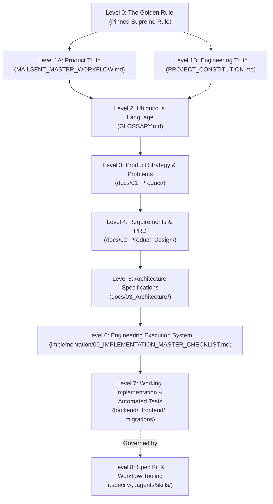

# MailSent — Spec Kit Integration & Workflow Audit Report

> **Document Type:** Governance & Architecture Integration Audit  
> **Date:** 2026-08-18  
> **Status:** Final / Ratified for Engineering Integration  
> **Scope:** Integration of Spec Kit workflow tooling into MailSent's ~70% completed production SaaS repository.  
> **Governing References:** [MAILSENT_MASTER_WORKFLOW.md](MAILSENT_MASTER_WORKFLOW.md) · [PROJECT_CONSTITUTION.md](PROJECT_CONSTITUTION.md) · [00_IMPLEMENTATION_MASTER_CHECKLIST.md](../../implementation/00_IMPLEMENTATION_MASTER_CHECKLIST.md)

---

## Executive Summary

MailSent is an existing, ~70% implemented, production-oriented AI Email Infrastructure Intelligence Platform (Java 21 / Spring Boot / Next.js / PostgreSQL / Redis). The codebase possesses a mature, highly disciplined, multi-tiered documentation and governance system with frozen architectural boundaries, immutable domain models, strict definition of done (DoD), and an exhaustive 32-phase Engineering Execution System (`implementation/00_IMPLEMENTATION_MASTER_CHECKLIST.md`).

Spec Kit has recently been initialized in the repository (`.specify/` and `.agents/skills/`). 

This audit evaluates the relationship between the existing MailSent engineering governance and Spec Kit, establishes an unambiguous authority hierarchy, maps Spec Kit constructs to existing assets, prevents workflow conflicts and duplication, and defines the exact integration model for Antigravity and development agents.

---

## 1. Current Architecture of Our Documentation System

MailSent's documentation is structured into four authoritative tiers plus an execution framework:

```
docs/
├── 00_Foundation/
│   ├── MAILSENT_MASTER_WORKFLOW.md     # Operational & Product Truth (V1 Final)
│   ├── PROJECT_CONSTITUTION.md          # Engineering Truth & Supreme Philosophy (v3.1)
│   └── GLOSSARY.md                      # Ubiquitous Domain Language & Entity Definitions
├── 01_Product/
│   ├── PRODUCT_VISION.md                # Long-term vision and market framing
│   ├── PRODUCT_POSITIONING.md           # Positioning vs. EasyDMARC, dmarcian, Valimail
│   ├── VALUE_PROPOSITION.md             # Core value pillars and buyer psychology
│   ├── CUSTOMER_PROBLEMS.md             # Validated customer problems (CP-1 to CP-8)
│   └── CUSTOMER_JOURNEY.md              # Customer lifecycle journey (J-1 to J-6)
├── 02_Product_Design/
│   ├── PRODUCT_REQUIREMENTS.md          # High-level PRD & module requirements
│   ├── FUNCTIONAL_REQUIREMENTS.md       # Granular functional specs (D/H/X/E/P/G/M/R/C/F)
│   ├── NON_FUNCTIONAL_REQUIREMENTS.md   # Security, Reliability, Performance, Observability
│   ├── AI_REQUIREMENTS.md               # AI Layer specifications (AIR-AI1 to AIR-AI12)
│   ├── REQUIREMENTS_TRACEABILITY_MATRIX # Cross-cutting trace: CP -> Req -> Arch -> Task
│   └── RELEASE_STRATEGY.md              # Version gates, beta criteria, and rollout
├── 03_Architecture/
│   ├── 01_DOMAIN_MODEL.md               # Core domain entities & invariants
│   ├── 02_UBIQUITOUS_LANGUAGE.md        # Ubiquitous language implementation bindings
│   ├── 03_BOUNDED_CONTEXTS.md           # 15 Bounded contexts & context maps
│   ├── 04_INFORMATION_ARCHITECTURE.md   # System data flows & UI navigation
│   ├── 05_SYSTEM_ARCHITECTURE.md        # Monolith-first modular bounded-context architecture
│   ├── 06_AI_ARCHITECTURE.md            # AI orchestration, grounding, & evaluation
│   ├── 07_DATA_MODEL.md                 # Relational schemas, aggregates, & snapshots
│   ├── 08_API_PHILOSOPHY.md             # REST/RPC contracts & error schemas
│   ├── 09_SECURITY_ARCHITECTURE.md      # Least privilege, consent, encryption, audit
│   └── 10_DEPLOYMENT_ARCHITECTURE.md    # Docker Compose, infrastructure, CI/CD
implementation/
├── README.md                            # Execution framework operating manual
├── 00_IMPLEMENTATION_MASTER_CHECKLIST.md # 32-phase Engineering Execution System (511 lines)
└── 05_REPO_006_VALIDATION_REPORT.md     # Baseline repository validation report
```

### Direction of Truth

Per `implementation/README.md` and Constitution §21, the direction of truth is strictly one-way:
$$\text{Customer Value} \longrightarrow \text{Requirements} \longrightarrow \text{Architecture} \longrightarrow \text{Execution Checklist} \longrightarrow \text{Implementation}$$

- **Implementation follows documentation.**
- **Documentation NEVER follows implementation.**
- **Code follows architecture; architecture is frozen.**

---

## 2. Authority Hierarchy

Where conflicts, ambiguities, or competing guidance arise, the following strict authority hierarchy governs:



### Authority Rules:
1. **The Golden Rule (Level 0):** *"No feature is approved because it is technically impressive. Every feature must solve a validated customer problem and create recurring value. (Will customer pay a monthly subscription for this for 12+ months? If NO -> REJECT)."*
2. **Product vs. Engineering Truth (Level 1A vs Level 1B):** Resolved via Constitution §3.5:
   - `MAILSENT_MASTER_WORKFLOW.md` is supreme for **Product Truth** (what we build, customer hierarchy, 12 modules, pricing, feature pipeline, kill list, V1 exclusions, V2 triggers).
   - `PROJECT_CONSTITUTION.md` is supreme for **Engineering Truth** (how we build, architectural principles, DoD, Non-Negotiable Rules N1–N8, code quality, security standards).
3. **Spec Kit Status (Level 8):** Spec Kit is a **subordinate tooling accelerator**. It does **NOT** have authority to alter product requirements, introduce unauthorized technologies, modify the domain glossary, override frozen architecture decisions, or bypass the Master Checklist.

---

## 3. Spec Kit Mapping to Existing MailSent Assets

| Spec Kit Concept / Artifact | MailSent Existing Equivalent | Relationship & Integration Directive |
| :--- | :--- | :--- |
| **Constitution** (`.specify/memory/constitution.md`) | `docs/00_Foundation/PROJECT_CONSTITUTION.md` + `MAILSENT_MASTER_WORKFLOW.md` | **Direct Mirror / Link.** Spec Kit's constitution must synchronize from `PROJECT_CONSTITUTION.md`. Generic template principles (e.g. CLI/Library-first) must be completely replaced with MailSent's ratified principles. |
| **Feature Specification** (`specs/<id>/spec.md`) | `docs/02_Product_Design/PRODUCT_REQUIREMENTS.md` & `FUNCTIONAL_REQUIREMENTS.md` | **Feature-Level Slice.** When implementing a new bounded phase or delta feature, `spec.md` acts as a local operational slice that cites the parent `FUN-xxx` / `AIR-xxx` requirement. |
| **Clarification Workflow** (`/speckit-clarify`) | Feature Pipeline Step 2 (Requirements clarification) | **Pre-Plan Gate.** Uses clarification questions to resolve ambiguous edge cases against frozen docs before generating plans. |
| **Implementation Plan** (`specs/<id>/plan.md`) | `docs/03_Architecture/` (01–10) + Phase Technical Specifications | **Architectural Conformance Plan.** Must cite existing Bounded Contexts, Data Models, and frozen CTO decisions. Cannot invent new architecture patterns. |
| **Task Breakdown** (`specs/<id>/tasks.md`) | `implementation/00_IMPLEMENTATION_MASTER_CHECKLIST.md` Phase Tasks | **Phase Task Execution Slice.** Tasks in `tasks.md` must correspond directly to checklist tasks (e.g. `MAP-002`, `DIAG-002`, `COMP-001`) and adhere to the 30–90 min constraint. |
| **Checklists** (`specs/<id>/checklists/`) | Mandatory Checklist (MPL) & Standard Matrices (T-MAT, S-MAT, O-MAT, D-MAT, AI-MAT) | **Validation Artifact.** Operationalizes the MPL checklist for the specific feature under development. |
| **Consistency Analysis** (`/speckit-analyze`) | Constitution §26 (Review Checklist) & Traceability Matrix | **Quality Gate.** Evaluates cross-artifact consistency between spec, plan, and tasks against the Project Constitution. |
| **Implementation Engine** (`/speckit-implement`) | Constitution §19 (Definition of Done) & `implementation/README.md` | **Execution Vehicle.** Executes tasks with strict adherence to TDD, regression checks, and DoD compliance. |

---

## 4. Missing Pieces in Spec Kit Setup

1. **Unconfigured Constitution (`.specify/memory/constitution.md`):** Currently contains an empty, generic scaffold referencing `[PROJECT_NAME]`, `[PRINCIPLE_1_NAME]`, and CLI/library examples that violate MailSent's SaaS web application architecture.
2. **Template Customization:** Spec Kit's default `spec-template.md`, `plan-template.md`, and `tasks-template.md` do not currently enforce MailSent's mandatory metadata:
   - Traceability anchors (`CP`, `J`, `VP`, `FUN`, `AIR`, `NFR`, `Arch`, `WF`).
   - Golden Rule Gating & Recurring Value Statement.
   - Standard Verification Matrices (T-MAT, S-MAT, O-MAT, D-MAT, AI-MAT).
   - Invariant citations (`INV-01` through `INV-12`).
3. **Checklist Synchronization Bridge:** No automated script or convention linking `specs/<id>/tasks.md` completion back to `implementation/00_IMPLEMENTATION_MASTER_CHECKLIST.md`.

---

## 5. Duplication Risks & Artifacts NOT to Duplicate

| Artifact / Concept | Location of Existing Record | Risk of Duplication | Action Required |
| :--- | :--- | :--- | :--- |
| **Core Architecture** | `docs/03_Architecture/` | High: Spec Kit plans might attempt to re-architect database schemas, bounded contexts, or API structures. | **DO NOT DUPLICATE.** Plans must reference `docs/03_Architecture/` and frozen CTO decisions as read-only invariants. |
| **Domain Glossary** | `docs/00_Foundation/GLOSSARY.md` | High: AI might invent duplicate or conflicting entity definitions. | **DO NOT DUPLICATE.** All entity naming must be pulled directly from `GLOSSARY.md`. |
| **Master Checklist** | `implementation/00_IMPLEMENTATION_MASTER_CHECKLIST.md` | Critical: Maintaining two independent task backlogs leads to split-brain progress tracking. | **DO NOT DUPLICATE.** `00_IMPLEMENTATION_MASTER_CHECKLIST.md` is the single source of truth for repository completion. `tasks.md` files are temporary execution projections. |
| **Product Requirements** | `docs/02_Product_Design/` | Medium: Creating detached specs that diverge from frozen functional requirements. | **DO NOT DUPLICATE.** Spec Kit specifications must cite explicit requirement IDs (e.g. `FUN-H1`, `FUN-E1`). |

---

## 6. Identified Conflicts & Ambiguities

### Conflict 1: Default Spec Kit Constitution vs. MailSent Project Constitution
- **Issue:** Spec Kit's default `.specify/memory/constitution.md` promotes a "Library-First" and "CLI Interface" philosophy.
- **Resolution:** MailSent is a modular SaaS platform. `.specify/memory/constitution.md` must be updated to mirror `docs/00_Foundation/PROJECT_CONSTITUTION.md` (v3.1) and enforce the Golden Rule, Non-Negotiable Rules N1–N8, and Natural Flow DNA.

### Conflict 2: Spec Kit Plan Autonomy vs. Frozen Architecture
- **Issue:** Spec Kit's `/speckit-plan` default prompt allows the AI to freely select tech stacks, libraries, and design patterns.
- **Resolution:** In MailSent, the stack is **LOCKED** (Java 21, Spring Boot, Next.js, TypeScript, Tailwind, PostgreSQL, Redis, Maven, Docker Compose) and architecture decisions are frozen. Spec Kit plans must operate strictly as *Implementation Designs* within the frozen architecture.

### Conflict 3: Task Execution & Progress Drift
- **Issue:** Spec Kit marks tasks done in `specs/<feature>/tasks.md`. If this is not mirrored into `implementation/00_IMPLEMENTATION_MASTER_CHECKLIST.md`, team visibility is broken.
- **Resolution:** Any execution performed via `/speckit-implement` must update the corresponding task in `00_IMPLEMENTATION_MASTER_CHECKLIST.md` according to the Task Status Legend (🟦 Code Complete, 🟪 Tests Complete, 🟩 Review Complete, ✅ Done).

---

## 7. Recommended Integration Architecture

Spec Kit should be integrated as a **Scoped Feature Delivery Engine** operating strictly under the governance of the Master Workflow and Project Constitution.

```
┌────────────────────────────────────────────────────────────────────────┐
│               MAILSENT MASTER WORKFLOW (Operational Truth)              │
│       - 12 Core Modules Scope        - Feature Approval Formula (80+)  │
│       - Natural Flow Product DNA     - V1 Exclusions & Kill List       │
└──────────────────────────────────┬─────────────────────────────────────┘
                                   │ Governs
┌──────────────────────────────────▼─────────────────────────────────────┐
│                 PROJECT CONSTITUTION (Engineering Truth)                │
│       - The Golden Rule              - Non-Negotiable Rules (N1-N8)    │
│       - Definition of Done (10 pts)  - Architecture & AI Principles    │
└──────────────────────────────────┬─────────────────────────────────────┘
                                   │ Enforces
┌──────────────────────────────────▼─────────────────────────────────────┐
│            ENGINEERING EXECUTION SYSTEM (Checklist & Phases)           │
│       - 00_IMPLEMENTATION_MASTER_CHECKLIST.md (32 Phases)              │
│       - Mandatory Checklist (MPL) & Verification Matrices (T/S/O/D/AI)  │
└──────────────────────────────────┬─────────────────────────────────────┘
                                   │ Dispatches Unbuilt Tasks
┌──────────────────────────────────▼─────────────────────────────────────┐
│                 SPEC KIT FEATURE DELIVERY PIPELINE                     │
│                                                                        │
│   1. /speckit-specify    ──> Create scoped spec.md from FUN/AIR req    │
│   2. /speckit-clarify    ──> Resolve ambiguities via targeted questions│
│   3. /speckit-plan       ──> Produce plan.md aligned to Architecture   │
│   4. /speckit-tasks      ──> Generate tasks.md mapped to Checklist IDs │
│   5. /speckit-analyze    ──> Verify consistency & Constitution rules   │
│   6. /speckit-implement  ──> Execute code + tests (MPL / DoD verified) │
│   7. Checklist Sync      ──> Update 00_IMPLEMENTATION_MASTER_CHECKLIST │
└────────────────────────────────────────────────────────────────────────┘
```

---

## 8. Antigravity Operational Protocol with Spec Kit Skills

When Antigravity or any subagent is tasked with building or refining MailSent features, it must follow this protocol:

1. **Command / Skill Selection:**
   - Use `/speckit-specify` when receiving a new feature or unbuilt module request.
   - Use `/speckit-clarify` to disambiguate edge cases before architectural design.
   - Use `/speckit-plan` to design the Java/TypeScript implementation while binding strictly to `docs/03_Architecture/` and `GLOSSARY.md`.
   - Use `/speckit-tasks` to break down the work into 30–90 min tasks bearing explicit traceability anchors.
   - Use `/speckit-analyze` to perform a non-destructive audit before any code is generated.
   - Use `/speckit-implement` to execute code, migrations, and automated tests.

2. **Strict Guardrails during Skill Execution:**
   - **Never violate Non-Negotiable Rules N1–N8.**
   - **Never guess or fabricate delivery health states (INV-01, INV-05).**
   - **Never bypass automated tests (T-MAT).**
   - **Never alter frozen architectural documents or existing passing migrations.**
   - **Always update `implementation/00_IMPLEMENTATION_MASTER_CHECKLIST.md` upon completing work.**

---

## 9. Minimum Integration Changes Required

To establish this integration cleanly without disrupting existing code or documentation, the following lightweight actions are required:

1. **Populate `.specify/memory/constitution.md`:**
   - Update `.specify/memory/constitution.md` to reflect `docs/00_Foundation/PROJECT_CONSTITUTION.md` and `MAILSENT_MASTER_WORKFLOW.md`.
2. **Align Spec Kit Templates (`.specify/templates/`):**
   - Enhance `spec-template.md` to include MailSent Traceability Anchors (`CP`, `Req`, `Arch`, `WF`) and the Golden Rule statement.
   - Enhance `plan-template.md` to mandate inclusion of Bounded Context references, Flyway migration numbering checks, and Invariant validations.
   - Enhance `tasks-template.md` to format task IDs compatible with the Master Checklist (e.g. `[PHASE-ID]`, `MPL` compliance).
3. **Preserve Master Workflow Authority:**
   - Ensure all agent rule definitions emphasize that `MAILSENT_MASTER_WORKFLOW.md` is the operational master.

---

## 10. Exact Next Steps

1. **Step 1 (Governance Sync):** Populate `.specify/memory/constitution.md` with MailSent's ratified constitutional principles (v3.1) so that Spec Kit skills read the correct project invariants.
2. **Step 2 (Template Calibration):** Update the templates in `.specify/templates/` to include MailSent traceability metadata and verification checklists.
3. **Step 3 (Targeted Execution Selection):** Select the next unblocked phase from `implementation/00_IMPLEMENTATION_MASTER_CHECKLIST.md` (e.g., Phase 08 Infrastructure Map visualization `MAP-002`/`MAP-003`, Phase 09 `DIAG-002` Sender Detection, or Phase 18 Compliance `COMP-001`) to run through the Spec Kit workflow.
4. **Step 4 (Validation):** Execute the chosen phase using `/speckit-specify` $\rightarrow$ `/speckit-plan` $\rightarrow$ `/speckit-tasks` $\rightarrow$ `/speckit-implement`, and verify that the Master Checklist updates seamlessly upon completion.

---

*Audit Complete. No product code or existing documentation was modified. Awaiting confirmation to proceed to template calibration or targeted feature execution.*
